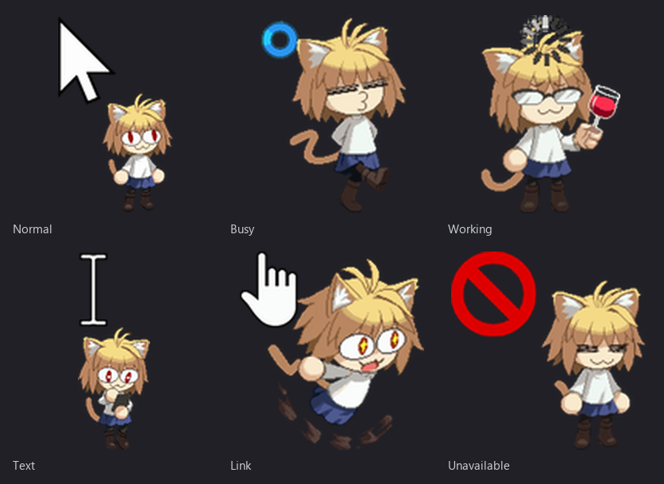
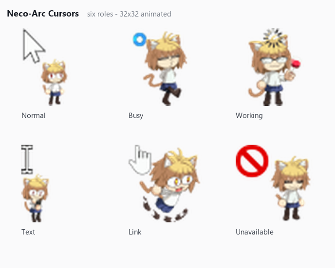

# Neco-Arc Cursors

Neco-Arc（猫姬）主题的 Windows 动画鼠标指针，六个角色一套，带一键安装脚本。

Animated Neco-Arc cursor pack for Windows 11 — six roles, one-click installer.

---

## 两个版本 / Two versions

| 版本 | 画布 | 制作 | 说明 |
|---|---|---|---|
| **v2**（最新） | 128×128 | 由 [Sweezy Cursors](https://sweezy-cursors.com/) 提供的光标转换服务导出 | 分辨率更高，放大后更清晰，推荐 |
| v1 | 32×32 | RealWorld Cursor Editor | 初版，体积小 |

两版的光标形态、目录结构和安装方式完全一致，只是素材分辨率不同。

Both versions share the same six cursors and the same installer; v2 is rendered at 128×128 for sharper edges. v2's cursor files were exported through the conversion service provided by [Sweezy Cursors](https://sweezy-cursors.com/).

v1 预览 / v1 preview

---

## 包含哪几个光标 / What's inside

| 槽位 Slot | 文件 File | 说明 |
|---|---|---|
| 正常选择 / Normal Select | `arrow.ani` | 箭头 + 角色 |
| 忙 / Busy | `busy-top-left.ani` / `busy-bottom-left.ani` | 两个版本，默认左上 |
| 后台运行 / Working | `working.ani` | 角色 + 头顶加载圈 |
| 文本选择 / Text | `text.ani` | I 形指针 + 角色 |
| 链接选择 / Link | `hand.ani` | 手型 + 角色 |
| 不可用 / Unavailable | `unavailable.ani` | 禁止符号 + 角色 |

32×32（v1）或 128×128（v2）动画光标，Windows 会按缩放比例选取渲染尺寸。

---

## 安装 / Install

### 方式一：手动换（推荐）

设置 → 蓝牙和其他设备 → 鼠标 → 相关设置「其他鼠标设置」→「指针」选项卡
→ 选中某一项 → 点「浏览」，选 `cursors-en\` 里对应的文件 → 应用。

Settings → Bluetooth & devices → Mouse → Additional mouse settings → Pointers tab
→ select an item → Browse → pick the file from `cursors-en\`.

手动换不依赖脚本，之后调整鼠标大小也不会被覆盖。

### 方式二：脚本一键

解压后双击 `双击安装.bat`，看到「安装完成」即可，无需重启。
撤销：双击 `恢复默认.bat`。

Double-click `双击安装.bat`. To undo, run `恢复默认.bat`.

解压出来的文件夹**不能移动、改名或删除**——注册表里记的是绝对路径。

---

## 注意 / Notes

- 用脚本装完后，再去系统设置里改「鼠标大小」，指针会变回默认。要改大小请手动换，或装完后别动那一栏。
- 光标大小建议 1～2 档，调得太大画面会糊。
- 弹「无法验证发布者」是 `.bat` 的正常提示，点「运行」即可。

- Changing "Mouse pointer size" after the script install resets cursors to default.
- Pointer size 1–2 looks best; larger sizes look blurry.
- The "unknown publisher" prompt is normal for unsigned `.bat` files.

---

## 下载 / Download

到 [Releases](../../releases) 下载最新压缩包：v2 是 `neco-arc-cursor-v2.zip`，v1 是 `neco-arc-cursors-release.zip`。

Download the latest zip from [Releases](../../releases): `neco-arc-cursor-v2.zip` (v2) or `neco-arc-cursors-release.zip` (v1).

---

## 版权 / Credits & License

- 角色 **Neco-Arc（猫姬）** 版权归 **TYPE-MOON**，本包为**非商业的同人作品**，免费分享。
- 角色像素素材来自 [Tenor 上的 Neco-Arc GIF](https://tenor.com/zh-CN/search/neko-arc-gifs)，非本项目绘制；如权利人要求，会立即下架。
- 光标的拼装与调整使用 **RealWorld Cursor Editor** 完成（v1）。
- **v2** 的光标文件由 [Sweezy Cursors](https://sweezy-cursors.com/) 提供的光标转换服务导出，分辨率更高、更为清晰；该服务与本项目无隶属关系。
- 安装脚本（`install.ps1` / `uninstall.ps1` / `.bat`）由 **DeepSeek** 协助编写，以 MIT 许可发布，详见 [LICENSE](LICENSE)——**该许可不覆盖角色与图像素材**。

Character **Neco-Arc** © TYPE-MOON. This is a non-commercial fan work, shared for free.
Sprite art comes from Neco-Arc GIFs on Tenor and is not drawn by this project.
Installer scripts are MIT licensed; the license does NOT cover the character or artwork.
